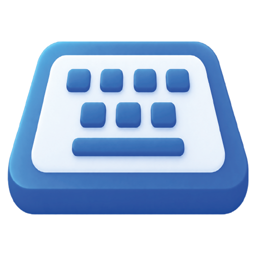
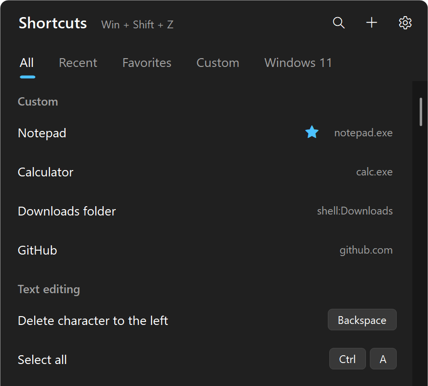
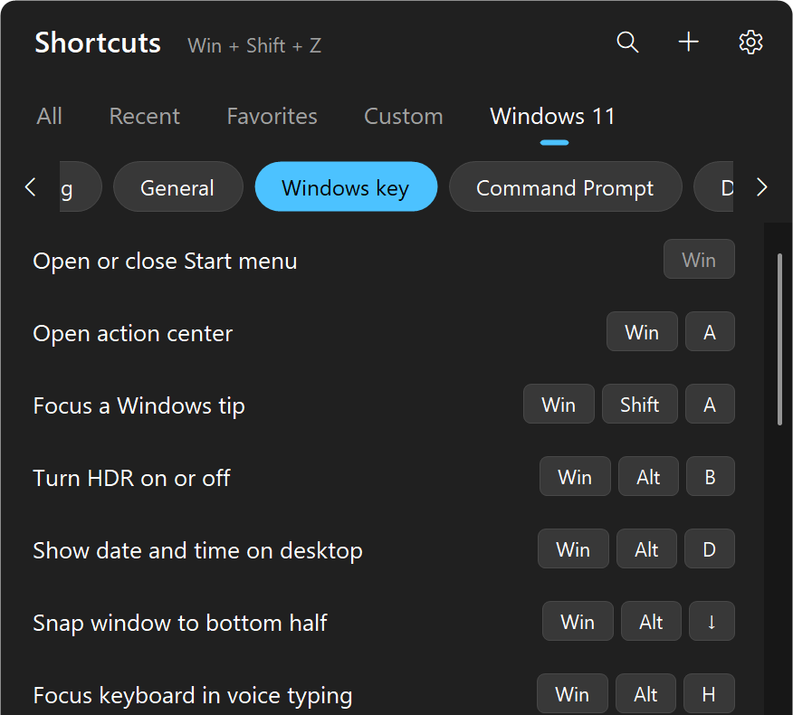
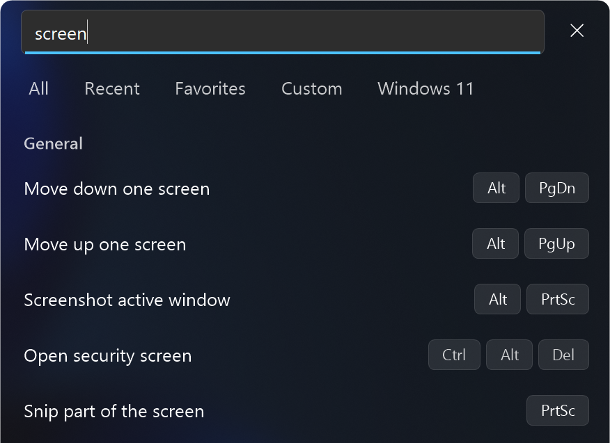

<p align="center">
  
</p>

<h1 align="center">AutoShortcut</h1>

<p align="center">
  <b>Every Windows 11 keyboard shortcut, one click away.</b><br>
  Press <kbd>Win</kbd> + <kbd>Shift</kbd> + <kbd>Z</kbd>, find the shortcut you need and click it.
</p>

<p align="center">
  
  
  
</p>

## What it does

- **All the Windows 11 shortcuts** (over 200), organized in the same sections as Microsoft's guide.
- **Click to run**: no need to remember the keys, AutoShortcut presses them for you in the window you were using.
- **Search**: just start typing ("screenshot", "desktop", "win v"…).
- **Favorites and recent** shortcuts always at hand.
- **Your own shortcuts**: open a program, a folder or a website with your own key combination (or just with a click), or keep another app's combination as a reminder.
- **Move any Windows shortcut** to other keys, and put them all back with one button. AutoShortcut tells you when a combination is already taken, and by what.
- Light and dark mode and the see-through look of Windows 11. Free, no ads, nothing to configure.

## Install

Open **PowerShell** (no administrator rights needed), paste this and press Enter:

```powershell
irm https://raw.githubusercontent.com/alons-dev/auto-shortcut/main/install.ps1 | iex
```

That's it. AutoShortcut starts right away, shows its icon next to the clock and opens by itself every time you sign in. Run the same command again to update; your shortcuts are kept.

Works on Windows 10 and 11.

## How to use it

| To… | Do this |
|---|---|
| Open or close it | <kbd>Win</kbd> + <kbd>Shift</kbd> + <kbd>Z</kbd>, or click its icon in the system tray |
| Run a shortcut | Click it |
| Find a shortcut | Start typing, or click 🔍 |
| Browse by section | **Windows 11** tab, then pick a section |
| Add to favorites | Click the ☆ that appears on a shortcut, or right-click it |
| Create your own | **+** button |
| Edit, move or delete yours | Right-click it |
| Change the keys of a Windows shortcut | Right-click it › **Edit hotkey** |
| Put the Windows shortcuts back | ⚙ button › **Restore Windows shortcuts** |
| Change the key that opens it | ⚙ button |
| Close it | <kbd>Esc</kbd>, or click anywhere else |

A few shortcuts appear dimmed: they need the mouse, a number, or Windows doesn't let apps press them (like <kbd>Ctrl</kbd> + <kbd>Alt</kbd> + <kbd>Del</kbd>). They're there so you can look them up.

## Uninstall

From **Settings › Apps › Installed apps › AutoShortcut › Uninstall**, or with this command in PowerShell:

```powershell
& "$env:LOCALAPPDATA\Programs\AutoShortcut\uninstall.ps1"
```

Your own shortcuts are kept in case you come back. To delete them too, add `-RemoveSettings` to the command:

```powershell
& "$env:LOCALAPPDATA\Programs\AutoShortcut\uninstall.ps1" -RemoveSettings
```

Already uninstalled and want to delete them now? Run:

```powershell
Remove-Item "$env:APPDATA\AutoShortcut" -Recurse -Force
```

## Good to know

- **Another app uses Win + Shift + Z?** AutoShortcut tells you. Pick another combination with the ⚙ button.
- **Windows running as administrator** don't accept keys from normal apps, so shortcuts won't reach them.

---

<p align="center">
  <a href="docs/DEVELOPMENT.md">How it's built</a> ·
  <a href="LICENSE">MIT License</a>
</p>
